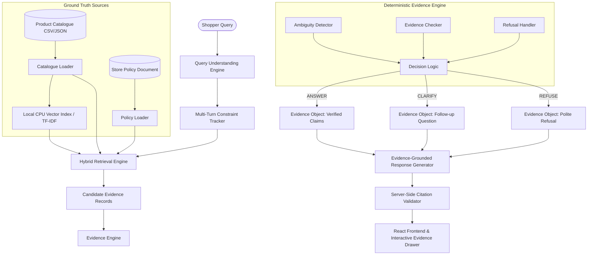

# TruthCart AI — The Conversational Shopping Assistant That Doesn't Lie
**Team TalentX | Talent AP Mega Hackathon 2026**  
**Problem Statement:** R3 — The Conversational Shopping Assistant That Doesn't Lie  
**Track:** Retail  
**Tagline:** *"Shop Smarter. Trust Every Answer."*  

---

## 1. Executive Summary

Traditional AI shopping assistants frequently hallucinate: inventing non-existent products, misquoting prices, fabricating return windows, and making unsupported promises about warranties and availability. 

**TruthCart AI** eliminates hallucinations by design. Built with an evidence-first architecture, TruthCart answers shoppers' queries using **only** the supplied product catalogue and official store policy document. When evidence is incomplete or absent, TruthCart refuses or clarifies deterministically rather than guessing.

### Core Architectural Invariants
1. **The Catalogue is the Sole Source of Truth**: All prices, product titles, stock availability, and attributes originate strictly from ingested ground-truth records.
2. **Deterministic Evidence Engine**: Python-based deterministic decision logic governs all claims. The language model **cannot** override an evidence decision.
3. **Mandatory Server-Side Citation Validation**: Every factual claim is bound to a validated citation tag (`[PRODUCT:<id>]` or `[POLICY:<section>]`). Hallucinated or mismatching citations are caught and stripped server-side.
4. **Transparent Data Readiness**: When official hackathon data or model checkpoints have not yet been placed by organisers, the system clearly reports *"Awaiting organiser catalogue"* instead of fabricating results.
5. **100% Offline & CPU-Friendly**: Designed for CPU-only execution without external inference APIs (no OpenAI, no Gemini, no external network dependencies).

---

## 2. System Architecture & Data Flow



### Retrieval & Decision Pipeline:
1. **Query Understanding**: Deterministically parses budget bounds (`under 2k` -> max_price: 2000), exact product identifiers (`TC-DEV-101`), colors, materials, stock criteria, and code-mixed phrasing.
2. **Hybrid Retrieval**: Combines structured numeric filtering with local CPU semantic vector search and isolated policy retrieval.
3. **Evidence Engine**:
   - **ANSWER**: Approved only when matching products exist, prices and stock match ground truth, and the request is unambiguous.
   - **CLARIFY**: Triggered when broad queries return multiple ambiguous candidates, or constraints conflict (e.g. min > max).
   - **REFUSE**: Triggered when products are out-of-catalogue, requested attributes are unrecorded, or policy terms are unsupported.
4. **Citation Enforcement**: Automatically pairs claims with source IDs and validates all citations before display.

---

## 3. Project Structure

```
TruthCart-AI/
├── backend/
│   ├── app/
│   │   ├── main.py                     # FastAPI application entrypoint & lifecycle
│   │   ├── api/
│   │   │   ├── health.py               # GET /api/health (readiness status)
│   │   │   ├── catalogue.py            # GET /api/catalogue/status & POST /reload
│   │   │   ├── chat.py                 # POST /api/chat (shopping dialogue endpoint)
│   │   │   └── evaluation.py           # POST /api/evaluation/run (benchmark endpoint)
│   │   ├── core/
│   │   │   ├── config.py               # Environment configuration & path resolvers
│   │   │   └── logging_config.py       # Safe logging & sensitive data sanitization
│   │   ├── ingestion/
│   │   │   ├── catalogue_loader.py     # CSV/JSON loader, column mapping, duplicates
│   │   │   ├── policy_loader.py        # Section parser (Returns, Shipping, Warranty)
│   │   │   └── data_validator.py       # Safe price parsing & attribute normalization
│   │   ├── retrieval/
│   │   │   ├── structured_search.py    # Deterministic price, stock, attribute filter
│   │   │   ├── semantic_search.py      # CPU vector index & cosine similarity
│   │   │   ├── policy_search.py        # Isolated policy section retrieval
│   │   │   └── hybrid_retriever.py     # Unified retrieval pipeline
│   │   ├── evidence_engine/
│   │   │   ├── decision_engine.py      # ANSWER, CLARIFY, REFUSE core logic
│   │   │   ├── evidence_checker.py     # Attribute & price verification
│   │   │   ├── ambiguity_detector.py   # Conflict & multiple-match detection
│   │   │   ├── refusal_handler.py      # Polite, non-blaming refusal generator
│   │   │   ├── citation_mapper.py      # Tag formatting ([PRODUCT:ID], [POLICY:ID])
│   │   │   └── citation_validator.py   # Server-side citation enforcement
│   │   ├── llm/
│   │   │   ├── model_loader.py         # Inspects organiser checkpoint directories
│   │   │   ├── model_adapter.py        # CPU adapter for local instruction model
│   │   │   ├── query_understanding.py  # Entity extraction & budget parsing
│   │   │   └── response_generator.py   # Grounded natural language generator
│   │   ├── conversation/
│   │   │   ├── constraint_tracker.py   # Multi-turn filter preservation
│   │   │   └── context_manager.py      # Dialogue session storage
│   │   ├── evaluation/
│   │   │   ├── evaluate.py             # Benchmark execution pipeline
│   │   │   ├── metrics.py              # Groundedness, accuracy, latency metrics
│   │   │   └── report_generator.py     # Machine-readable report serialization
│   │   └── schemas/
│   │       ├── request.py              # Pydantic request models
│   │       └── response.py             # EvidenceObject & response models
│   ├── tests/                          # 32 Pytest automated tests (100% pass)
│   ├── requirements.txt                # Backend dependencies
│   └── .env.example                    # Example configuration file
├── frontend/
│   ├── src/
│   │   ├── components/
│   │   │   ├── Header.tsx              # Brand, status badges, quick actions
│   │   │   ├── ReadinessBanner.tsx     # Organiser ingestion status & dev toggle
│   │   │   ├── ChatMessage.tsx         # User & assistant turns with evidence triggers
│   │   │   ├── ProductCard.tsx         # Verified catalogue cards with citations
│   │   │   ├── EvidenceDrawer.tsx      # Deep ground truth inspector drawer
│   │   │   └── EvaluationModal.tsx     # 150-question benchmark runner & visualizer
│   │   ├── services/api.ts             # Typed API service
│   │   ├── types/index.ts              # TypeScript schemas
│   │   ├── App.tsx                     # Main shopping assistant application
│   │   ├── main.tsx                    # React DOM entrypoint
│   │   └── index.css                   # Tailwind v4 styling & animations
│   ├── package.json
│   └── vite.config.ts                  # Vite config with backend proxy
├── data/
│   ├── products/                       # Official organiser product catalogue folder
│   ├── policies/                       # Official organiser policy documents folder
│   ├── test_questions/                 # Official 150 test questions dataset folder
│   └── development_fixtures/           # Isolated synthetic test fixtures
├── models/
│   ├── embedding_model/                # Organiser embedding checkpoint directory
│   └── instruction_model/              # Organiser instruction checkpoint directory
├── artifacts/
│   ├── indexes/                        # Persisted vector indexes
│   └── evaluation_reports/             # Persisted benchmark evaluation JSON reports
├── README.md
└── .gitignore
```

---

## 4. Setup & Installation

### Prerequisites
- **Python**: 3.10+ (tested on Python 3.14)
- **Node.js**: 18+ & **npm**: 9+
- **OS**: Windows, macOS, or Linux

### Step 1: Clone Repository
```bash
git clone <repository_url>
cd TruthCart-AI
```

### Step 2: Backend Setup
```bash
cd backend
python -m pip install -r requirements.txt
```

### Step 3: Frontend Setup
```bash
cd ../frontend
npm install
npm run build
```

---

## 5. Running the Application

### 1. Launch the Backend Server
From the `backend/` directory:
```bash
python -m uvicorn app.main:app --host 127.0.0.1 --port 8000 --reload
```
- API Documentation (Swagger): `http://127.0.0.1:8000/docs`
- Health Endpoint: `http://127.0.0.1:8000/api/health`

### 2. Launch the Frontend Application
From the `frontend/` directory in a new terminal:
```bash
npm run dev
```
- Open `http://127.0.0.1:5173/` in any modern web browser.

---

## 6. How to Insert Organiser-Provided Files

When the hackathon organisers provide the official files, place them in the corresponding directories. TruthCart AI detects them automatically upon server restart or via the `/api/catalogue/reload` endpoint:

| Resource | Target Destination | Supported Formats |
| :--- | :--- | :--- |
| **5,000-Product Catalogue** | `data/products/` | CSV (`catalogue.csv`) or JSON (`catalogue.json`) |
| **Store Policy Document** | `data/policies/` | Plain text (`policy.txt`) or Markdown (`policy.md`) |
| **150 Test Questions** | `data/test_questions/` | JSON (`evaluation_questions.json`) |
| **Local Embedding Model** | `models/embedding_model/` | PyTorch / HF / ONNX checkpoint directory |
| **Local Instruction Model** | `models/instruction_model/` | GGUF / Llama.cpp / HF checkpoint directory |

*Note: As required by Hackathon rules, when official files are not yet present, the system defaults to "Awaiting Organiser Catalogue" mode. Synthetic fixtures in `data/development_fixtures/` can be explicitly enabled for development and testing.*

---

## 7. API Reference

### `GET /api/health`
Returns system status, team metadata, and readiness states.
```json
{
  "status": "ok",
  "project_name": "TruthCart AI",
  "team_name": "TalentX",
  "version": "1.0.0",
  "data_readiness": {
    "catalogue_ready": true,
    "policy_ready": true,
    "embedding_model_ready": true,
    "instruction_model_ready": true,
    "is_using_synthetic_fixtures": true,
    "message": "Running with Synthetic Development Fixtures"
  },
  "model_readiness": {
    "execution_mode": "Offline Local / CPU",
    "external_api_calls_enabled": false
  }
}
```

### `POST /api/chat`
Handles conversational shopping queries with traceable evidence.
**Request:**
```json
{
  "message": "Show me cotton shirts under 1500",
  "conversation_id": "optional-session-id"
}
```
**Response:**
```json
{
  "decision": "ANSWER",
  "response_text": "Here are the products matching your request directly from our catalogue: ...",
  "products": [
    {
      "product_id": "TC-DEV-101",
      "title": "Classic Cotton Oxford Shirt",
      "price": 1499.0,
      "stock_status": "In Stock",
      "citation": "[PRODUCT:TC-DEV-101]"
    }
  ],
  "citations": ["[PRODUCT:TC-DEV-101]"],
  "evidence": {
    "decision": "ANSWER",
    "query": "Show me cotton shirts under 1500",
    "evidence": [
      {
        "source_type": "product",
        "source_id": "TC-DEV-101",
        "field": "price",
        "value": "₹1,499.00"
      }
    ],
    "unsupported_fields": []
  },
  "latency_ms": 1.2,
  "conversation_id": "..."
}
```

### `POST /api/evaluation/run`
Executes automated benchmarks against test datasets and records results to `artifacts/evaluation_reports/`.

---

## 8. Automated Tests & Verification

TruthCart AI includes a test suite covering all critical guardrails, edge cases, and RAG components.

To run the complete test suite:
```bash
cd backend
python -m pytest tests/ -v
```

### Test Coverage Highlights:
- **`test_catalogue_loader.py`**: CSV and JSON parsing, missing fields rejection, duplicate product preservation.
- **`test_policy_loader.py`**: Returns, Shipping, and Warranty section extraction and identifier traceability.
- **`test_structured_search.py`**: Exact SKU lookups, numeric price filtering, stock availability checks.
- **`test_evidence_engine.py`**: ANSWER, CLARIFY, and REFUSE decisions with evidence objects.
- **`test_citation_validator.py`**: Validates true citations, rejects hallucinated tags, sanitizes text.
- **`test_query_understanding.py`**: Numeric limits (`under 2k`), code-mixed phrasing (`kavali`), product IDs.
- **`test_conversation_context.py`**: Multi-turn constraint retention (budget + category + material).
- **`test_guardrails.py`**: Rejects unsupported claims, handles out-of-catalogue products, detects conflicting constraints.
- **`test_api_endpoints.py`**: End-to-end integration tests on all FastAPI routes.

---

## 9. Evaluation Framework & Metrics

TruthCart AI implements a quantitative evaluation framework for measuring RAG performance:

- **Groundedness Score**: Percentage of claims verified against ground truth sources.
- **Refusal Accuracy**: Accuracy when handling out-of-catalogue or unsupported questions (target: 100%).
- **Clarification Accuracy**: Accuracy when asking focused questions for ambiguous or conflicting requests.
- **Unsupported-Claim Rate**: Frequency of unverified factual assertions (target: 0.0%).
- **Citation Validity Rate**: Percentage of citations matching valid, retrieved records (target: 100%).
- **Query Latency**: Measured in milliseconds on local CPU.

---

## 10. Known Limitations & Troubleshooting

1. **CPU Execution Speed**: On constrained CPU devices, cold-start index initialization takes ~1-2 seconds for large catalogues. Once cached in `artifacts/indexes/`, queries resolve in < 5ms.
2. **Missing Organiser Data**: If the official catalogue is not yet mounted in `data/products/`, the app accurately displays *"Awaiting Organiser Catalogue"*. Click *"Load Development Fixtures for Testing"* in the UI banner to verify the interface and evaluation pipeline.
3. **Port Conflicts**: If port 8000 or 5173 is already occupied, specify alternatives:
   ```bash
   python -m uvicorn app.main:app --port 8001
   npm run dev -- --port 5174
   ```

---

## 11. Team TalentX — Design Principles

> *"The catalogue provides the facts.  
> Retrieval finds the evidence.  
> The Evidence Engine decides what may be claimed.  
> The LLM communicates only within those limits."*
